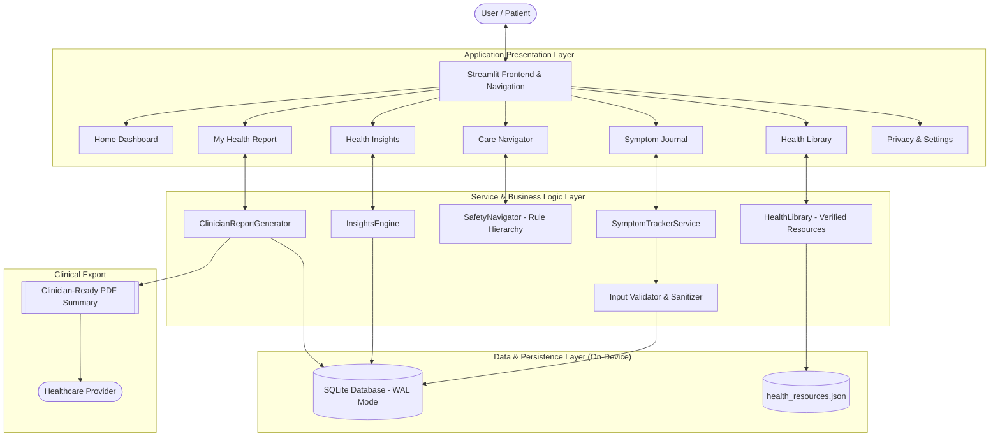

# HERPath AI — System Architecture & Design Documentation
## recHERsion 2026 | PS1: Women's Healthcare
**Organized by:** ACM-W, NITK Surathkal  
**Project:** HERPath AI — Women's Health Intelligence & Care Navigation Platform

---

## 1. High-Level Architectural Overview

HERPath AI is architected with a **privacy-first, modular, layered design** built specifically for single-device resilience, explainable intelligence, and zero third-party data transmission. 

The architecture separates UI components, application logic, deterministic safety rules, statistical analytics, and database persistence into distinct, independently testable Python modules.

---

## 2. Core Modules & Responsibilities

| Module | File | Primary Responsibility |
|---|---|---|
| **Entrypoint** | `app.py` | Multi-page Streamlit application, profile switcher, and reactive UI state management. |
| **Config** | `config.py` | Taxonomy, clinical disclaimers, priority enums, database filepaths, and color tokens. |
| **Data Models** | `models.py` | Strongly typed dataclasses for `UserProfile` and `SymptomEntry` with serialization methods. |
| **Validation** | `validators.py` | Input sanitization, bounds checking (severity 1-10, duration <= 720h, date validation). |
| **Database** | `database.py` | SQLite schema creation, WAL mode, transaction context manager, foreign-key cascade enforcement, and profile-scoped queries. |
| **Symptom Tracker** | `symptom_tracker.py` | High-level business operations for recording, editing, querying, and deleting symptom history. |
| **Insights Engine** | `insights_engine.py` | Deterministic statistical analysis, Plotly visualizations, trajectory trends, and explainable contextual pattern rules. |
| **Safety Navigator** | `safety_navigator.py` | Rule-based clinical triage hierarchy (Emergency, Prompt, Routine, Self-Care) based on WHO/ACOG/NHS protocols. |
| **Health Library** | `health_library.py` | Verified educational resources from WHO, NHS, CDC, ACOG with keyword and category search. |
| **Report Generator** | `report_generator.py` | ReportLab PDF compiler producing structured, non-diagnostic clinical consultation summaries. |
| **Seed Seeder** | `data/seed_data.py` | Realistic, completely fictional demonstration data generator covering 3 distinct health profiles. |

---

## 3. Database Schema & Data Integrity

The SQLite relational database (`data/herpath.db`) uses strict foreign-key constraints and indexes:

### `profiles` Table
- `id` (TEXT PRIMARY KEY): Unique identifier (e.g. `demo_priya`, `user_custom`).
- `display_name` (TEXT NOT NULL): User name or alias.
- `created_at` (TEXT NOT NULL): ISO 8601 creation timestamp.
- `preferences_json` (TEXT NOT NULL): JSON object containing tracking preferences (e.g. `track_menstrual: bool`).

### `symptom_entries` Table
- `id` (INTEGER PRIMARY KEY AUTOINCREMENT): Unique entry record ID.
- `profile_id` (TEXT NOT NULL): Foreign key referencing `profiles(id)` with `ON DELETE CASCADE`.
- `category` (TEXT NOT NULL): Taxonomy category (e.g., *Pelvic & Menstrual*, *Neurological & Head*).
- `symptom` (TEXT NOT NULL): Name of symptom.
- `onset_date` (TEXT NOT NULL): Recorded date in `YYYY-MM-DD` format.
- `onset_time` (TEXT): Optional time of onset.
- `severity` (INTEGER NOT NULL): Validated integer between 1 and 10.
- `duration_hours` (REAL): Duration in hours (nullable).
- `status` (TEXT NOT NULL): State: `'Ongoing'`, `'Resolved'`, or `'Intermittent'`.
- `impact` (TEXT): Daily functional impairment level.
- `notes` (TEXT): User-entered qualitative observations.
- `context_json` (TEXT): JSON containing optional observations (sleep quality, stress, energy, cycle phase).
- `created_at` (TEXT NOT NULL): Timestamp of entry creation.
- `updated_at` (TEXT NOT NULL): Timestamp of entry modification.

### `medications` Table
- `id` (INTEGER PRIMARY KEY AUTOINCREMENT): Unique medication entry ID.
- `profile_id` (TEXT NOT NULL): Foreign key referencing `profiles(id)` with `ON DELETE CASCADE`.
- `name` (TEXT NOT NULL): Name of medication or intervention.
- `category` (TEXT NOT NULL): `Prescription`, `OTC / Supplement`, or `Lifestyle / Physical Therapy`.
- `dosage` (TEXT): Strength or dose (e.g. `50 mg`).
- `frequency` (TEXT): Administration frequency.
- `started_date` (TEXT NOT NULL): Date regimen began.
- `notes` (TEXT): Clinical instructions or doctor notes.
- `created_at` (TEXT NOT NULL): Timestamp of entry.

### Indices
- `idx_symptoms_profile_date`: Optimizes chronologically sorted queries scoped by profile.
- `idx_symptoms_category`: Accelerates categorical filtering.
- `idx_symptoms_name`: Optimizes frequency calculations.
- `idx_medications_profile`: Optimizes medication lookups scoped by profile.

---

## 4. Privacy & Responsible Medical Design

1. **Zero External Data Transmission:** Operates 100% on the user's local workstation. No external API calls are required for core features.
2. **Transparent, Deterministic Logic:** No unvalidated machine-learning or black-box predictive models make clinical diagnoses.
3. **Clinical Boundaries:** Prominent disclaimers remind users that HERPath AI organizes personal health history but does not diagnose conditions or replace licensed medical care.
4. **Emergency Priority Isolation:** Critical warning signs (thunderclap headache, hemorrhagic bleeding, acute pelvic collapse) immediately trigger emergency evaluation instructions and are never silenced or delayed by analytics or AI fallback.
